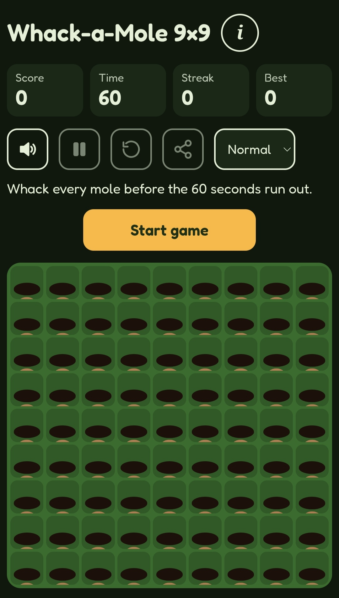

# Whack-a-Mole 9×9

A fast browser version of Whack-a-Mole on a 9×9 grid of 81 holes. Whack as many moles as you can in 60 seconds, unlock mole skins and hammers, and collect achievements.

**Play it:** https://c-apps-n-games.github.io/whack-a-mole/

<!-- Add a screenshot named screenshot.png to the repository, or delete the line above. -->

## How to play

Tap or click a mole to hit it. The round ends when the 60-second timer runs out.

| Mole | What it does |
| --- | --- |
| Regular mole | 1 point |
| Golden mole (yellow) | 5 points, but it leaves quickly |
| Clock mole (blue) | Adds 3 seconds. Up to 5 can appear per round |
| Bomb mole (dark, orange ring) | Costs 3 points and resets your streak |

Every 5 hits in a row adds 1 more point per hit, up to +5. Tapping an empty hole resets your streak.

## Features

- **Three difficulty modes:** Easy (slower moles, fewer bombs), Normal, and Chaos (faster moles, more at once, more bombs).
- **Mole skins:** Classic, Ninja, Pirate, Robot and Disco. Skins unlock at 50, 150, 300 and 500 total whacks. Pick one or leave it on Random.
- **Hammer skins:** Wooden, Rubber mallet, Golden, Ice, Neon and Candy. They unlock from whack totals and achievements.
- **Eight achievements,** each with confetti.
- **Speech bubbles:** each mole type has its own lines.
- **Sound effects** with an on/off toggle.
- **Pause and reset buttons.** The game also pauses when you switch tabs.
- **Share button** for your score.
- **Light and dark mode,** following your device setting.
- **Reduced motion support** for people who prefer less animation.
- Works with mouse, touch and keyboard.

## Saved progress

Your best score, total whacks, chosen skins and achievements are saved in your browser's local storage. They stay on that device and in that browser. Clearing browser data or switching devices starts you over.

## Run it locally

The whole game is one file, `index.html`, with no build step and no dependencies. Open it in a web browser. The only outside request is the Google Fonts stylesheet, and the game falls back to a system font without it.

## Publish your own copy

1. Fork or download this repository.
2. In the repository's Settings, open Pages.
3. Choose "Deploy from a branch", then the `main` branch and the `/ (root)` folder, and save.
4. After a minute or two, the game is live at `https://YOUR-USERNAME.github.io/REPO-NAME/`.

## License

Add the license you prefer here, for example MIT, and include a `LICENSE` file in the repository.
